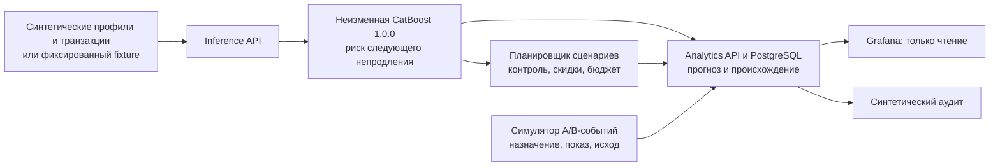

# M6: система, данные и сценарий демонстрации

Этот документ описывает готовый локальный хакатонный показ и остаётся материалом для ваших правок к презентации. Здесь показано, что видит зритель, откуда берутся данные и что потребуется для применения системы в бизнесе. Модель `lumen-temporal-catboost` 1.0.0 уже получена и разрешена к использованию в этом демо. Её файл и веса не меняем. На реальных пользователях систему не запускаем.

Полная карта **каждого endpoint, контракта, источника и всех 27 панелей** вместе с новым пошаговым запуском для Grafana — в [SYSTEM_FLOW_AND_DASHBOARDS_RU.md](SYSTEM_FLOW_AND_DASHBOARDS_RU.md). Этот M6-документ остаётся сценарием трёх тестовых ситуаций, которые записываются без пауз.

## 1. Как выглядит система со стороны

Для зрителя это последовательность: **получили риск → подготовили предложение эксперимента → показали, как были бы связаны события → посмотрели результат в Grafana**. Модель оценивает риск непродления; тесты и варианты скидок предлагает отдельный планировщик. Демо-исходы задаёт симулятор, они не являются предсказаниями модели. Создание настоящего A/B-теста в Adapty и выдача оффера здесь не происходят.

| Компонент | Что делает сейчас | Где смотреть |
| --- | --- | --- |
| Inference API `:8001` | Загружает фиксированную модель и отдельный мок, проверяет вход, отвечает на `/v1/predict`; `/v1/retention/plan` строит предложение и считает бюджет/порог безубыточности. | [API и маршруты](../services/inference/app/main.py), [планировщик](../services/inference/app/economics.py) |
| Analytics API `:8002` | Сохраняет прогнозы, предложения и явно симулированные события; возвращает их для проверки. | [Обработчики](../services/analytics/app/main.py), [OpenAPI](openapi/analytics.openapi.json) |
| PostgreSQL | Хранит записи и представления траекторий риска; повтор события с тем же ключом не создаёт вторую запись. | [Таблицы событий](../postgres/init/005-experiment-lineage.sql), [представления риска](../postgres/init/003-temporal-predictions.sql) |
| Grafana `:3000` | Читает PostgreSQL без права записи. Показывает источник прогноза и отдельно симулированные события. | Дашборды ниже |

Текущие снимки интерфейсов: [Inference OpenAPI](openapi/inference.openapi.json) и [Analytics OpenAPI](openapi/analytics.openapi.json). Живые схемы доступны на `http://localhost:8001/openapi.json` и `http://localhost:8002/openapi.json` при запущенном Compose.

## 2. Что именно видно в Grafana

Первые четыре дашборда описывают **offline синтетический архив**. Пятый показывает прогнозы фиксированной модели и симулированную цепочку событий. Данные одного экрана не следует автоматически считать причиной данных другого.

| Дашборд | Графики и таблицы | Что они означают |
| --- | --- | --- |
| [1. Data and Model Health — Offline](http://localhost:3000/d/model-health) | Число строк по загруженным файлам; **Stored prediction sources** по `mock`/`external`, модели и версии; установки по дням; размер выбранного сегмента. | Инвентарь данных. Таблица прогнозов не проверяет, работает ли сервис прямо сейчас, и не измеряет качество модели. |
| [2. Business and Revenue — Offline](http://localhost:3000/d/business-revenue) | Пользователи и пользователи с транзакциями; транзакции по продукту; покупки по дням; возвраты и billing issues по каналам. | Описательные срезы синтетических покупок, без эффекта скидки. |
| [3. Behavior and Segments — Offline](http://localhost:3000/d/behavior-segments) | Группы A/B по поведению первого дня; пересечение групп; редактирования по цели onboarding; импорт фото и push; полосы активности по каналу; состав по платформе и стране. | Описательные сегменты. Поле `ab_test` в профиле не доказывает рандомизацию или показ предложения. |
| [4. Campaign Tracking — Offline](http://localhost:3000/d/smart-retention) | Состав placement/flow; записанные названия A/B-тестов; пользователи с транзакциями по названию теста; статус измерения исходов. | Архивные поля и ограничение измерения. Это не таблица фактических назначений и не график uplift. |
| [Churn Risk Over Time (Synthetic Lumen)](http://localhost:3000/d/churn-risk-trajectory) | Средний текущий риск; иллюстративная выручка под риском; текущие прогнозы по псевдонимам; траектория риска, изменение между прогнозами и средний риск по дням; крупнейшие изменения; число симулированных событий; таблица «назначение → показ → исход/ожидание». | Для модели выбрать `Prediction source=external`, `app=lumen-demo`, `model=lumen-temporal-catboost`, `version=1.0.0`. Переключение на `mock` показывает отдельный статический источник. Выручка под риском не равна спасённой выручке. |

На живом показе сначала открыть инвентарь модели, затем дашборд риска. Для таблицы событий выбрать период, включающий UTC-время симуляции. Если панель пуста, проверить фильтры и диапазон дат, а не подставлять числа вручную. Версия демо-политики есть в JSON-выводе односценарного `m5_demo.py`; в Grafana и отчёте трёх тестов этой версии сейчас нет.

## 3. Model I/O: где код и какие входы

Путь одного прогноза:

1. [Схема запроса](../contracts/schemas/temporal-churn-request.schema.json) и [пример](../contracts/examples/temporal-churn-request.json) задают `user_id` (псевдоним), `model_id`, `request_id`, 23 поля `features`, `as_of_at` и `renewal_due_at` в UTC. Полный перечень и смысл признаков — в [замороженном контракте](CHURN_PREDICTION_IO.md).
2. [Маршрут `/v1/predict`](../services/inference/app/main.py) выбирает адаптер по `model_id`, проверяет схему, время среза и дату следующего продления. Он передаёт признаки модели и отправляет результат в Analytics API.
3. [Адаптер CatBoost](../services/inference/app/adapters/temporal_catboost.py) проверяет ID, версию `1.0.0`, порядок 23 признаков и SHA-256 файла `model.cbm` (`4f3fd0acc9944b19fd0743d3c0b8a8863b8d59e1e81065c5a0940d5b9fad1491`). Он загружает исходный CBM и возвращает число риска в `[0,1]`. Обучения или обновления весов в сервисе нет.
4. Выход содержит `prediction_id`, псевдоним, значение риска, модель/версию, `prediction_source=external`, время прогноза и временной контекст. `external` обозначает происхождение **модели**; в демо её входы всё равно синтетические.

### Откуда берутся значения сейчас и где искать их в будущем

| Группа данных | В текущем демо | Для реального решения |
| --- | --- | --- |
| 23 признака модели | Зафиксированные синтетические случаи из [fixture](../tests/fixtures/temporal_churn_fixture.json). [Offline replay](../scripts/score_temporal_snapshots.py) использует синтетические профили и транзакции, но не является рабочим источником признаков для клиентов. | Датированные значения профиля, активности и подписки, известные **до** `as_of_at`. Профильные значения без времени изменения не позволяют восстановить прошлое состояние. |
| Покупка, продукт, цена, дата истечения, billing issue, refund | Локальные `users.csv.gz` (50 000 строк) и `transactions.csv.gz` (29 794 строки) из seed-репозитория; [импорт](../services/analytics/import_offline.py) проверяет их схему. | Проверенный ключ профиля и поток/экспорт транзакционных событий. У Adapty есть [webhook событий подписки](https://adapty.io/docs/handle-webhooks-with-ai.md) и [аналитический экспорт](https://adapty.io/docs/export-analytics-api.md), но пригодность конкретных полей и исторических срезов нужно проверять отдельно. |
| Статический мок риска | [MockChurnAdapter](../services/inference/app/adapters/mock.py) возвращает 12 заранее записанных значений для `demo-u01`…`demo-u12` и запасное значение `0.50`. Они ни из Adapty, ни из обученной модели. | Мок заменяется фактическими входными признаками и ответом фиксированной модели; Adapty не должен поставлять «готовый churn risk» для этой модели. |
| Назначение варианта, показ, исход | [M5 demo](../scripts/m5_demo.py) создаёт события `source=simulated`; два CSV не содержат подтверждённого назначения и показа. | Нужны отдельные ID теста/варианта, UTC-события назначения и показа и связанный зрелый исход. Adapty поддерживает [A/B-тесты](https://adapty.io/docs/ab-tests.md) и [ленту событий](https://adapty.io/docs/event-feed.md), но наличие **нужной связи на уровне одного пользователя** в доступном экспорте ещё не подтверждено; при необходимости её фиксирует приложение. |

Особая граница: offline `price_index` вычисляется по всему архиву транзакций; такой расчёт может использовать будущие чеки. Поэтому replay годится для иллюстрации, но не для реального прогноза на дату решения. Подробнее — [карта недостающих данных](M6_DATA_REQUIREMENTS.md).

## 4. Порядок презентации

1. **Вот наша система.** Открыть две API и схему выше. Показать `/v1/models`: отдельно `mock-churn-v1` и `lumen-temporal-catboost` 1.0.0. Объяснить, что в демо один синтетический профиль проходит через модель и сохраняется с версией и временем среза.
2. **Вот решение, которое она поддерживает.** Прогноз риска идёт в планировщик. Он предлагает контрольную группу и варианты скидок, считает максимальную номинальную стоимость и порог безубыточности. Это гипотезы, не «оптимальная скидка» и не доказанная экономия.
3. **Вот как выглядел бы A/B-процесс.** Локальная проверка черновика отвечает `ready_for_operator_review`, `mode=local_dry_run`, `writes_to_adapty=false`. Симулятор добавляет назначение, показ и исход; запись без показа остаётся ожидающей. Grafana показывает связь, синтетический аудит исключает незрелые/непоказанные записи.
4. **Вот чего не хватает для бизнеса.** Согласовать момент решения и права на реальные данные; получать датированные признаки и транзакции без будущих событий; проверить источники назначения и показа в Adapty/приложении; связать зрелый исход продления с вариантом; отдельно проверить модель на целевой аудитории. Лишь после проверки контента, цен и ответственности оператор мог бы создать и запустить реальный тест. Все эти действия находятся за пределами M6.
5. **Как исследователь мог бы работать дальше.** Если когда-нибудь понадобится новая модель, отдельный владелец ML сначала утверждает цель, временные срезы, зрелые метки, train/holdout разделение и проверку калибровки на подходящих данных. Симулированные A/B-исходы не подходят ни для обучения churn-модели, ни для оценки эффекта скидки. Текущий артефакт 1.0.0 в хакатоне остаётся неизменным.

## 5. Скрипт нескольких симулированных тестов

**Готовый артефакт:** [scripts/m6_multi_demo.py](../scripts/m6_multi_demo.py) и один JSON-отчёт в `.agent-runtime/`. Скрипт использует запущенные локальные API, исходный файл модели и fixture; в Adapty запросов на запись нет. Это демонстрация нескольких **предложений планировщика**, после которых создаются отдельные симулированные события. Модель сама тесты не создаёт и не предсказывает их результат.

| Сценарий | Входное предложение | Симулированный результат, который показать |
| --- | --- | --- |
| A | Контроль и скидка 10%, отдельный `experiment_id` и псевдонимизированная группа. | Назначение → показ → зрелый исход; показать одну полную связку. |
| B | Контроль и скидка 20%, другой `experiment_id` и другая группа. | Назначение и показ есть, исход для одного показанного участника ещё не наблюдается; запись остаётся `outcome_pending` и не входит в аудит зрелых исходов. |
| C | Контроль и скидка 30%, третий `experiment_id` и третья группа. | Назначение есть, показа нет; нельзя считать участника получившим предложение. |

Скрипт фиксирует fixture, UTC-время событий, модель/версию/checksum, `source=simulated`, параметры предложения и ID событий. Он создаёт по одному JSON-блоку на тест с прогнозами, предложенными вариантами, симулированными назначениями, показами, зрелыми/ожидающими исходами и причинами исключения. Повтор события с тем же ключом проверяется как дубликат, конфликтующий повтор — как ошибка. У тестов разные `experiment_id` и псевдонимы; отчёт не сравнивает «эффективность» скидок.

Запуск из интеграционного дерева с работающим Compose: `python scripts/m6_multi_demo.py --output .agent-runtime/m6-demo.json`. Каждый запуск по умолчанию получает новый `run-id`, чтобы предложения с неизменяемым `experiment_id` не конфликтовали с прошлым прогоном. [M6 gate](../scripts/gate.sh) запускает этот скрипт, односценарный [M5 demo](../scripts/m5_demo.py), аудит и проверки Grafana. Полный M6 gate прошёл на `develop` SHA `35faa1722a2295f1f5073c00f314473eeadda900`: 86 тестов прошли, 7 пропущены; сценарии A/B/C создали соответственно 3/2/2, 3/2/1 и 3/1/1 события назначения/показа/исхода. Проверены пять дашбордов. Демо остаётся синтетическим.

## Что проверить перед утверждением сценария

- Достаточно ли трёх случаев A/B/C для рассказа или нужен другой набор гипотез?
- Какие значения прогноза и поля событий вывести на экран без полного JSON?
- Нужна ли отдельная таблица результатов тестов в Grafana или достаточно текущих панелей lineage и итогового JSON?
- Какие источники Adapty уже доступны вашей команде на уровне событий конкретного профиля? Наличие полей в seed CSV этого не доказывает.
