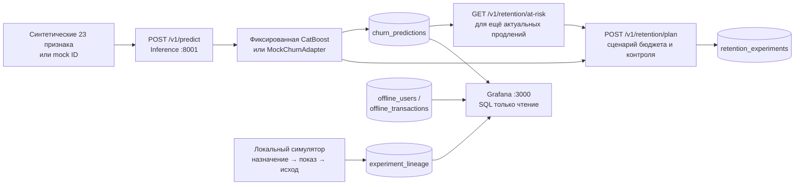

# Как работает Smart Retention Offers и что показывает Grafana

Этот гид — карта работающего локального демо. Здесь **тест** означает локальное предложение планировщика и симулированные события. Настоящий тест в Adapty не создаётся и не запускается. Модель `lumen-temporal-catboost` 1.0.0 и её checksum остаются неизменными.

## 1. Четыре разных вида данных

| Метка | Что это | Откуда сейчас | Можно ли считать реальным результатом теста? |
| --- | --- | --- | --- |
| **Offline seed** | Синтетические профили и транзакции Lumen | Локальные `users.csv.gz` и `transactions.csv.gz` из [seed-репозитория](https://github.com/kpotehin/adapty-seed-data-hack/tree/main), импортированные в `offline_users` и `offline_transactions` | Нет. Это вымышленные записи. |
| **Mock prediction** | Заранее записанные вероятности `mock-churn-v1` | [MockChurnAdapter](../services/inference/app/adapters/mock.py): 12 ID `demo-u01`…`demo-u12`, для остальных `0.50` | Нет. Это проверка инфраструктуры, не модель. |
| **Fixed-model prediction on synthetic input** | Вероятность риска от неизменной CatBoost | [Адаптер](../services/inference/app/adapters/temporal_catboost.py) + [синтетический fixture](../tests/fixtures/temporal_churn_fixture.json) или offline replay; хранится в `churn_predictions` с `prediction_source=external` | Нет. `external` обозначает происхождение **артефакта модели**, а не реальность пользователей или доказанное качество на них. |
| **Simulated lineage** | Назначение, показ и зрелый/ожидаемый исход | [M6](../scripts/m6_multi_demo.py) и [M8](../scripts/m8_live_demo.py) пишут `source=simulated` в `experiment_lineage` | Нет. Исход задаётся сценарием, модель его не прогнозирует. |

Дополнительно `retention_experiments` хранит **предложения** планировщика. Это не выполненные тесты и не назначения Adapty. `actual_observations` — отдельная таблица для явно переданных метрик; текущий демонстрационный сценарий не использует её как доказательство эффекта.

## 2. Сквозной процесс



**Простой запуск инфраструктуры:** `docker compose up --build -d`, затем `python scripts/smoke_demo.py`. Smoke использует статический mock, проводит запросы через оба сервиса, сохраняет прогнозы и предложение, проверяет Grafana. Он ничего не отправляет в Adapty.

**Демо фиксированной модели:** `python scripts/m6_multi_demo.py --output .agent-runtime/m6-demo.json` создаёт три отдельные симулированные ситуации A/B/C без пауз. [M8 ниже](#7-пошаговый-показ-изменений-в-grafana) даёт управляемые паузы между записью прогнозов и событий.

**Будущий реальный цикл:** по разрешённым источникам Adapty и приложения собирают признаки с временем доступности → фиксированная модель получает срез на момент решения → оператор утверждает аудиторию, цену и контент → Adapty назначает вариант и приложение/SDK фиксирует показ → поток транзакций и исходов закрывает окно продления → только после зрелых исходов можно оценивать разницу с контролем. Ни один из этих внешних шагов сейчас не автоматизирован нашим демо.

## 3. За что отвечает каждый endpoint

Порты `8001` и `8002` принадлежат **нашим** сервисам; это не пути Adapty. Оба сервиса также имеют `/docs`, `/openapi.json`, `/health`. Контракты HTTP: [Inference OpenAPI](openapi/inference.openapi.json), [Analytics OpenAPI](openapi/analytics.openapi.json).

| Сервис и путь | Вход → выход | Чтение/запись и роль в процессе |
| --- | --- | --- |
| `GET :8001/v1/models` | Список зарегистрированных адаптеров, ID, версия, источник | Проверить наличие mock и фиксированной модели до показа. Не оценивает качество. |
| `GET :8001/v1/models/{model_id}/schema` | ID → JSON Schema признаков адаптера | Показать допустимый вход модели. Для mock признаки произвольны; для CatBoost нужны 23 поля. |
| `POST :8001/v1/predict` | `ChurnPredictionRequest` → `ChurnPredictionResult` | Проверяет модель, признаки и даты, вычисляет риск, пересылает результат в Analytics `POST /v1/ingest/predictions`. Не обучает модель. |
| `POST :8001/v1/retention/plan` | Кандидаты с риском, тарифом и ценой + бюджет/скидки → `RetentionPlanResult` | Считает сценарий, контроль, верхнюю границу номинальной скидки и алгебраические пороги безубыточности. Пересылает предложение в Analytics. Не запускает A/B-тест и не предсказывает эффект скидки. |
| `POST :8001/v1/retention/draft/check` | Пример когорты, синхронизации профиля и draft → локальный статус | Dry run проверки полей и ID. `ready_for_operator_review` не означает созданный или активный тест Adapty. |
| `POST :8002/v1/ingest/predictions` | `ChurnPredictionResult` → stored/duplicate | Записывает неизменяемую строку `churn_predictions`; одинаковый ID с другим содержимым даёт 409. Обычно вызывается из Inference. |
| `GET :8002/v1/predictions/{prediction_id}` | ID → сохранённый прогноз | Проверить значение, модель, версию, `prediction_source`, `as_of_at`, `predicted_at`, `plan_type`. |
| `GET :8002/v1/retention/at-risk?app_id=…` | App, модель/версия, UTC `as_of`, возраст, лимит → список актуальных кандидатов | Читает сохранённые прогнозы, отбрасывает уже наступившее продление, устаревшие срезы, неизвестный `plan_type` и вычисленные позже `as_of` прогнозы. Список можно подать в `/v1/retention/plan`. **Исторический M8 fixture сюда не проходит:** срок продления уже прошёл; M8 берёт только что полученные ответы модели напрямую. |
| `POST :8002/v1/ingest/experiments` / `GET :8002/v1/experiments/{id}` | План → сохранённый JSON / чтение | `retention_experiments` хранит предложение, не результат. Обычно вызывается из Inference. |
| `POST :8002/v1/ingest/lineage/{kind}` | Запись вида `actual-assignment`, `actual-exposure` или `next-renewal-outcome` → stored/duplicate | Сохраняет событийную связь по ID в `experiment_lineage`, проверяет порядок и зрелость. В демо всегда `source=simulated`. Слово `actual` в имени контракта обозначает тип будущего события, не источник данных текущего запуска. |
| `GET :8002/v1/lineage/{experiment_id}?app_id=…` | ID теста → связанные записи | Проверить, какие стадии реально записаны в локальном хранилище. M8 сверяет количество после каждой стадии. |
| `POST :8002/v1/ingest/actuals` | `ActualObservation` → stored/duplicate | Отдельный приём явно переданных агрегированных наблюдений; в M8 не используется. |
| `GET :8002/v1/metrics/churn-risk?app_id=…` | App → все сохранённые точки риска | Диагностический API. Grafana **не** вызывает его. |
| `GET :8002/v1/metrics/churn-trajectory?user_id=…` | Псевдоним + опциональные app/model → история риска одного подписчика | Диагностический API над `churn_risk_trajectory`. Нет параметра `source`; Grafana читает SQL-представление напрямую. |

Сервисный код: [Inference](../services/inference/app/main.py), [планировщик](../services/inference/app/economics.py), [Analytics](../services/analytics/app/main.py). **Все панели Grafana выполняют SQL напрямую в PostgreSQL** через `grafana_ro`, у которого только `SELECT`; HTTP `/v1/metrics/*` не является источником панелей.

## 4. Контракты модели и событий

| Объект | Контракт / пример | Что проверить |
| --- | --- | --- |
| Общий запрос/ответ прогноза | [churn-prediction-request](../contracts/schemas/churn-prediction-request.schema.json), [churn-prediction-result](../contracts/schemas/churn-prediction-result.schema.json), [пример запроса](../contracts/examples/churn-prediction-request.json) | `model_id`, псевдоним, `request_id`, риск `[0,1]`, версия, источник, UTC-время; `plan_type` опционален для старых клиентов. |
| `mock-churn-v1` | Схема доступна через `GET /v1/models/mock-churn-v1/schema`; [значения в коде](../services/inference/app/adapters/mock.py) | Нет обученного артефакта; возвращает фиксированное число по ID. |
| `lumen-temporal-catboost` 1.0.0 | [temporal-churn-request](../contracts/schemas/temporal-churn-request.schema.json), [пример](../contracts/examples/temporal-churn-request.json), [metadata](../services/inference/models/temporal_catboost/metadata.json), [SHA-256](../services/inference/models/temporal_catboost/model.cbm.sha256) | Ровно 23 признака в порядке metadata; `as_of_at`, `renewal_due_at` и горизонт согласованы; файл CBM проверен по checksum `4f3fd0acc9944b19fd0743d3c0b8a8863b8d59e1e81065c5a0940d5b9fad1491`. Подробная карта 23 признаков и ограничения временного среза — [CHURN_PREDICTION_IO.md](CHURN_PREDICTION_IO.md). |
| Предложение теста | [retention-plan-request](../contracts/schemas/retention-plan-request.schema.json) → [retention-plan-result](../contracts/schemas/retention-plan-result.schema.json), [пример](../contracts/examples/retention-plan-request.json) | Это контракт **планировщика**, не churn-модели и не API Adapty. `modeled_discount_uplift=false`; скидки — гипотезы. |
| Выборка кандидатов | [retention-at-risk-response](../contracts/schemas/retention-at-risk-response.schema.json) | Последний допустимый прогноз, поля происхождения и причины исключения в `counts`. |
| Будущая активация | [approved-cohort](../contracts/schemas/approved-cohort.schema.json), [profile-sync](../contracts/schemas/profile-sync.schema.json), [draft-test](../contracts/schemas/draft-test.schema.json) | Замороженные локальные описания для проверки перед интеграцией; M8 не вызывает Adapty. |
| События теста | [actual-assignment](../contracts/schemas/actual-assignment.schema.json), [actual-exposure](../contracts/schemas/actual-exposure.schema.json), [next-renewal-outcome](../contracts/schemas/next-renewal-outcome.schema.json) | `experiment_id`, `variation_id`, `assignment_id`, `prediction_id`, UTC event/ingest time, источник и ключ идемпотентности связывают стадии. |
| Отдельная метрика | [actual-observation](../contracts/schemas/actual-observation.schema.json) | Не подменяет событийный исход конкретного продления. |

Две модели различаются **источником вероятности**, а не HTTP-путём: один `/v1/predict` выбирает адаптер по `model_id`. CatBoost предсказывает риск следующего непродления; планировщик не является второй ML-моделью и не выдаёт прогноз результата скидки.

## 5. Откуда поступают строки PostgreSQL

| Таблица / view | Кто пишет и из чего | Где используется |
| --- | --- | --- |
| `offline_users` | [Явный импорт](../services/analytics/import_offline.py) `users.csv.gz`; 50 000 синтетических строк. `install_at`, страна, платформа, канал, onboarding, активность первого дня, `placement`, `flow`, `ab_test`. | Все четыре Offline дашборда. |
| `offline_transactions` | Тот же импорт `transactions.csv.gz`; 29 794 синтетических строк. `purchased_at`, продукт, цена, refund/billing timestamps; связь по `user_id`. | Business, Campaign Tracking. |
| `offline_imports` | Импорт записывает SHA-256, число строк и `imported_at` для двух архивов. | Data and Model Health, панель 1. |
| `churn_predictions` | `POST /v1/predict` → внутренний Analytics ingest. `mock` или фиксированная модель на синтетике. | Data and Model Health, панель 2; SQL views риска. |
| `churn_risk_trajectory` | [SQL view](../postgres/init/003-temporal-predictions.sql): все прогнозы, `LAG` предыдущего риска по пользователю/модели/версии, `effective_at=COALESCE(as_of_at,predicted_at)`, `risk × renewal_price_usd`. | Churn Risk, временные ряды и таблица роста. |
| `churn_risk_current` | SQL view выбирает последний прогноз для `(app,user,model,version)` из траектории. **Не** фильтрует наступившее продление или возраст признаков; для этого есть `/v1/retention/at-risk`. | Churn Risk, текущие stat/table. |
| `retention_experiments` | `/v1/retention/plan` → Analytics ingest. Предложение и предполагаемый бюджет. | В текущих Grafana панелях **не читается**; смотрите `GET /v1/experiments/{id}` или JSON-отчёт. |
| `experiment_lineage` | `POST /v1/ingest/lineage/{kind}`; M6/M8 записывают только `source=simulated`. | Churn Risk, панели 8–9. |
| `actual_observations` | `POST /v1/ingest/actuals`; отдельные агрегаты. | В текущих 27 панелях **не читается**. |

Grafana получает SQL-доступ из [источника данных](../grafana/provisioning/datasources/postgres.yaml). Панели берутся из пяти JSON в [grafana/dashboards](../grafana/dashboards); это точный источник формул и фильтров. Raw CSV не читаются Grafana напрямую.

## 6. Каждый дашборд и каждая панель

Для Offline экранов диапазон времени обычно фильтрует `offline_users.install_at`; в Business panel 3 дополнительно фильтруется `offline_transactions.purchased_at`. Фильтры platform/country/channel/goal/flow/test берутся из `offline_users`. Их значения описывают **поля архива**, не live аудиторию. При запуске M8 эти четыре экрана сохраняют те же числа, кроме панели источников прогнозов в первом экране.

### 1. [Data and Model Health — Offline](http://localhost:3000/d/model-health)

| № | Панель | Источник и вычисление | Изменится при M8? |
| --- | --- | --- | --- |
| 1 | Offline source rows | `offline_imports.source_name`, `row_count`, префикс `sha256`, `imported_at`. Инвентарь импорта. | Нет. |
| 2 | Stored prediction sources | `churn_predictions` группируется по `prediction_source`, `model_id`, `model_version`; `COUNT(*)`. Если внешних прогнозов нет, выводится поясняющая нулевая строка. | **Да:** число `external` прогнозов растёт. Это число сохранённых ответов, не метрика точности. |
| 3 | Installed users by day | `offline_users.install_at`, число строк по UTC-дням после выбранных фильтров. | Нет. |
| 4 | Selected segment size | `COUNT(*)` из `offline_users` после фильтров и диапазона установки. | Нет. |

### 2. [Business and Revenue — Offline](http://localhost:3000/d/business-revenue)

| № | Панель | Источник и вычисление | Изменится при M8? |
| --- | --- | --- | --- |
| 1 | Users and transaction users | `offline_users` LEFT JOIN `offline_transactions` по `user_id`; два `COUNT(DISTINCT …)`. | Нет. |
| 2 | Transactions by product | JOIN тех же таблиц; `COUNT(*)` чеков и `COUNT(DISTINCT user_id)` по `transactions.product`. | Нет. |
| 3 | Purchases by day | JOIN; `date_trunc('day', purchased_at)` и `COUNT(*)` с фильтром времени покупки. Это число чеков, не uplift. | Нет. |
| 4 | Refunds and billing issues by channel | LEFT JOIN; `refunded_at IS NOT NULL`, `billing_issue_detected_at IS NOT NULL`, число пользователей по `acquisition_channel`. | Нет. |

### 3. [Behavior and Segments — Offline](http://localhost:3000/d/behavior-segments)

Группы A/B здесь — **два набора фильтров просмотра** `offline_users`, а не рандомизированные arms теста. Один пользователь может попасть в обе группы.

| № | Панель | Источник и вычисление | Изменится при M8? |
| --- | --- | --- | --- |
| 10 | Group A vs B — first-day behavior | `offline_users`: число пользователей, средние `ai_edits_first_day`, `photos_imported`, число и доля `push_opt_in='yes'` в двух выбранных наборах фильтров. | Нет. |
| 11 | Users in both groups | `COUNT(*)` пользователей, удовлетворяющих фильтрам и A, и B. | Нет. |
| 1 | First-day edits by onboarding goal | Число и среднее `ai_edits_first_day` по `onboarding_goal` отдельно для A/B. | Нет. |
| 2 | Imported photos and push preference | Число и среднее `photos_imported` по `push_opt_in` отдельно для A/B. | Нет. |
| 3 | First-day edit bands by channel | `ai_edits_first_day` разбивается на `0`, `1–3`, `4–7`, `8+`; число по `acquisition_channel` и A/B. | Нет. |
| 4 | Cohort composition by platform and country | Число пользователей по `platform`, `country` и A/B. | Нет. |

### 4. [Campaign Tracking — Offline](http://localhost:3000/d/smart-retention)

| № | Панель | Источник и вычисление | Изменится при M8? |
| --- | --- | --- | --- |
| 1 | Placement and flow composition | `offline_users.placement`, `.flow`, `COUNT(*)` после фильтров. | Нет. |
| 2 | Recorded A/B test names | `offline_users.ab_test`, `COUNT(*)`; пустое значение становится `(none)`. Это имя в профиле, не подтверждение назначения. | Нет. |
| 3 | Transaction users by recorded test | `offline_users.ab_test` + LEFT JOIN `offline_transactions`; пользователи и пользователи с чеком по записанному имени. Без assignment/exposure нельзя назвать это эффектом теста. | Нет. |
| 4 | Outcome measurement status | Статический SQL-текст `Unavailable`: нужны назначение варианта, показ, зрелый исход и контроль. | Нет. |

### 5. [Churn Risk Over Time (Synthetic Lumen)](http://localhost:3000/d/churn-risk-trajectory)

Фильтры `source`, `app`, `model`, `version` берутся из `churn_risk_current`; `user` — MD5 псевдонима в этой view. Для M8 выберите `source=external`, `app=lumen-m8-<run-id>`, `model=lumen-temporal-catboost`, `version=1.0.0`. Сгенерированный скриптом URL задаёт эти значения и одного подписчика.

| № | Панель | Источник и вычисление | Что делает M8 |
| --- | --- | --- | --- |
| 1 | Current churn probability (mean of latest per subscriber) | `churn_risk_current`: `AVG(churn_probability)` и число последних прогнозов по подписчикам. | При добавлении новых подписчиков меняются число и среднее; второй срез одного подписчика заменяет его current-риск. |
| 2 | Expected next-renewal revenue at risk (not saved revenue) | `churn_risk_current`: `SUM(churn_probability × renewal_price_usd)`. | Меняется с прогнозами. **Не** спасённая выручка; исторические сроки в fixture уже прошли. |
| 3 | Current churn probability by subscriber (latest prediction) | `churn_risk_current`: MD5 псевдонима, `effective_at`, риск, разность с предыдущим, срок продления, риск × цена; верхние 50. | Новые строки, обновление последнего риска у одного подписчика. |
| 4 | Churn-risk trajectory (selected subscribers) | `churn_risk_trajectory`: `effective_at` и риск по выбранному MD5 пользователя, в интервале времени. | Первый, затем второй срез одного подписчика дают две точки. |
| 5 | Change in churn risk since the previous prediction (selected subscribers) | Та же view: `churn_probability_change` после `LAG`, только ненулевые изменения. | Второй срез добавляет изменение; в fixture риск **снижается**. |
| 6 | Mean churn risk across subscribers (daily) | `churn_risk_trajectory` по UTC-дням: средний риск и сумма `expected_revenue_at_risk_usd` всех прогнозов этого дня. | По мере записи появляются дневные точки. Это **все срезы**, а не только последние: возможен повтор одного подписчика в дне. |
| 7 | Largest risk changes in the selected time range | Та же view: ненулевые изменения `churn_probability_change`, отсортированные по абсолютной величине, верхние 25; знак изменения сохранён. | После второго среза показывает отрицательное изменение риска выбранного подписчика. |
| 8 | Simulated A/B lineage events (no measured effect) | `experiment_lineage`, `source='simulated'`: `COUNT(*)` по `variation_id` и `kind`, с фильтром UTC `event_at`. Только при выбранном `source=external`. | Ступени 5/6/7 добавляют 3 назначения, 2 показа, 1 исход. Это количество записей, не конверсия. |
| 9 | Simulated assignment to exposure to outcome (pending remains pending) | `experiment_lineage`: LEFT JOIN `actual-assignment` → `actual-exposure` → `next-renewal-outcome` по app/test/assignment/exposure; статус по наличию стадии. | `exposure pending` → `outcome pending` → `mature` для соответствующих строк. Не рассчитывает разницу с контролем. |

Источник SQL каждого пункта — [JSON дашборда](../grafana/dashboards/churn-risk-trajectory.json). В M8 запись в БД происходит сейчас, а `event_at` и `as_of_at` остаются историческими датами fixture. Поэтому визуальное обновление **в реальном времени** означает обновление панели после новой записи; ось времени показывает исходные синтетические UTC-даты.

## 7. Пошаговый показ изменений в Grafana

Из корня репозитория:

```bash
docker compose up --build -d
python scripts/m8_live_demo.py --pause
```

Скрипту нужен только Python 3.12 и работающие сервисы: CatBoost установлен внутри Inference-контейнера. Скрипт печатает готовый `GRAFANA:` URL с уникальным `app_id`, выбранным псевдонимом, историческим началом диапазона, `to=now` и `refresh=5s`. Откройте его **после первой стадии**. Если Grafana просит войти, используйте локальные учётные данные из вашего `.env`/Compose. На каждом приглашении сначала дождитесь обновления панели, затем нажмите Enter. При автоматическом показе: `python scripts/m8_live_demo.py --delay-seconds 8`.

Если четыре Offline экрана пусты, один раз импортируйте локальные синтетические архивы (эта команда **заменяет** предыдущий offline snapshot, а M8-сценарий сам в импорте не нуждается):

```bash
export OFFLINE_DATA_DIR="$PWD/.agent-runtime/offline-data"
docker compose up --build -d
docker compose exec -T analytics python -m services.analytics.import_offline
```

| Стадия | Что записано | Что смотреть |
| --- | --- | --- |
| 1 | Первый прогноз первого псевдонима | Risk панели 1–4; одна точка в 4. |
| 2 | Второй срез того же псевдонима | Панели 3–5: новый current-риск, две точки, отрицательное изменение. |
| 3 | Прогнозы ещё двух псевдонимов | Панели 1–3 и 6: три current-подписчика и дневные точки. |
| 4 | Локальный план: контроль, гипотетическая скидка 5%, бюджет | Grafana **не меняется**: предложение хранится отдельно. Скрипт печатает `EXPERIMENT` и `PLAN`; полный ответ можно открыть через `GET /v1/experiments/{experiment_id}`. |
| 5 | Три симулированных назначения | Панель 8: три `actual-assignment`; панель 9: три `exposure pending`. |
| 6 | Два симулированных показа | Панель 8: два `actual-exposure`; панель 9: две строки `outcome pending`, одна `exposure pending`. |
| 7 | Один симулированный зрелый исход | Панель 8: один `next-renewal-outcome`; панель 9: одна `mature`, одна `outcome pending`, одна `exposure pending`. |

Скрипт завершает отчётом `.agent-runtime/m8-live-demo.json` (права `0600`) с `app_id`, `experiment_id`, ID прогнозов, checksum и итоговыми количествами. Каждый запуск создаёт новые ID и отдельное приложение-фильтр, поэтому предыдущие прогоны не смешиваются. Проверить запись напрямую: `curl 'http://127.0.0.1:8002/v1/lineage/<experiment_id>?app_id=<app_id>'`. Итог должен быть **3 назначения / 2 показа / 1 исход**. Для быстрого запуска без пауз используйте `python scripts/m8_live_demo.py`; графики обновятся после ручного refresh.

Интервал `to=now` включает исторические даты fixture, а `refresh=5s` обновляет запросы к БД. Если панель 4/5 пуста, проверьте `var-user` из напечатанного URL и выбранный диапазон; если панели 8/9 пусты, проверьте `source=external`, app/model/version и диапазон по `event_at`. Не меняйте `event_at` на текущую дату: это разрушило бы хронологию исторического симулированного продления.

Если нужны **три отдельных сценария скидок** без покадровой паузы, используйте `python scripts/m6_multi_demo.py --output .agent-runtime/m6-demo.json`: A — 10%, B — 20%, C — 30%. Их искусственные исходы не сравнивают как измеренный uplift.

## 8. Что нужно от Adapty и приложения для реальных данных

| Наше поле или стадия | Что есть сейчас | Реальный кандидат на источник и что ещё проверить |
| --- | --- | --- |
| Профиль, продукт, платёж, цена, срок, возврат, billing issue | Вымышленные seed CSV | [Adapty subscription webhooks](https://adapty.io/docs/webhook) передают события покупок, продлений, возвратов и проблем оплаты; [типы и поля](https://adapty.io/docs/webhook-event-types-and-fields) нужно сопоставить с 23 признаками и устойчивым ID подписки. [S3](https://adapty.io/docs/s3-exports) / [GCS](https://adapty.io/docs/google-cloud-storage) дают исторический event export, но по расписанию примерно раз в сутки, а не live stream. |
| Срез признаков на момент решения | Fixture и частично seed history; некоторые профильные поля без времени изменения, offline `price_index` рассчитан по полному архиву | Нужны сохранённые `observed_at` **и** `available_at` каждого признака; продукт/цена следующего продления, статус auto-renew и признаки поведения до cutoff. Первые редактирования и импорт фото относятся к приложению, если эти события не отправляются в Adapty как атрибуты/события. Нельзя восстановить прошлое из текущего профиля или будущего чека. |
| Аудитория и предлагаемый вариант | Только локальный план | Проверенные placement/flow, товары, региональная доступность и сегмент. [Экспорт placement](https://adapty.io/docs/export-placements) описывает настройку, но не доказывает назначение конкретного пользователя. Реальный A/B-тест и его рандомизацию ведёт Adapty; наш план не должен дублировать назначение. |
| Факт назначения и показа | `source=simulated`; в `users.ab_test` есть только имя | Нужен per-user `experiment_id`, variant ID, UTC assignment и отдельный exposure/view event. [Adapty A/B docs](https://adapty.io/docs/ab-tests) требуют логировать показ для кастомных экранов через `logShowFlow`/`logShowPaywall`, иначе статистика просмотров неточна. Надо проверить, какие event-level экспорты доступны именно вашему приложению; при отсутствии нужного assignment/exposure — записывать в приложении. |
| Зрелый исход продления и связь с вариантом | Симулятор задаёт `renewed`/`paid_usd`; seed чек не связан с показом | Подписочные webhook-события [включают `subscription_renewed`, `subscription_expired`, refunds и billing issues](https://adapty.io/docs/webhook-event-types-and-fields). Нужны стабильный ключ подписки, тест/вариант, контроль, дедупликация и полный период наблюдения. Отсутствие renewal event до окончания окна не является доказанным непродлением. |

Adapty действительно экспортирует события и paywall visits в S3, но этот путь [публикуется раз в сутки](https://adapty.io/docs/s3-exports); для близкого к реальному времени цикла нужен webhook и/или собственный поток приложения. [Аналитический Export API](https://adapty.io/docs/api-export-analytics) возвращает агрегированные отчёты и не заменяет проверенную персональную цепочку назначения → показа → исхода. Ни один из этих внешних потоков сейчас не подключён к нашему локальному PostgreSQL.

## 9. Короткие правила интерпретации

- `prediction_source=external` + `source=simulated` означает **фиксированная внешняя модель на синтетическом профиле плюс симулированные события**.
- `ab_test` из seed CSV — профильная метка, не назначение варианта. Покупка из seed CSV — не доказательство показа оффера.
- `risk × price` — иллюстративная сумма под риском; скидка не даёт автоматически «спасённую выручку».
- `mature` в M8 означает, что **симулятор записал** событие с датой после срока продления; это не наблюдение из Adapty.
- Качество модели на клиентах, эффект скидки и готовность к рабочему запуску этим демо не подтверждены.
